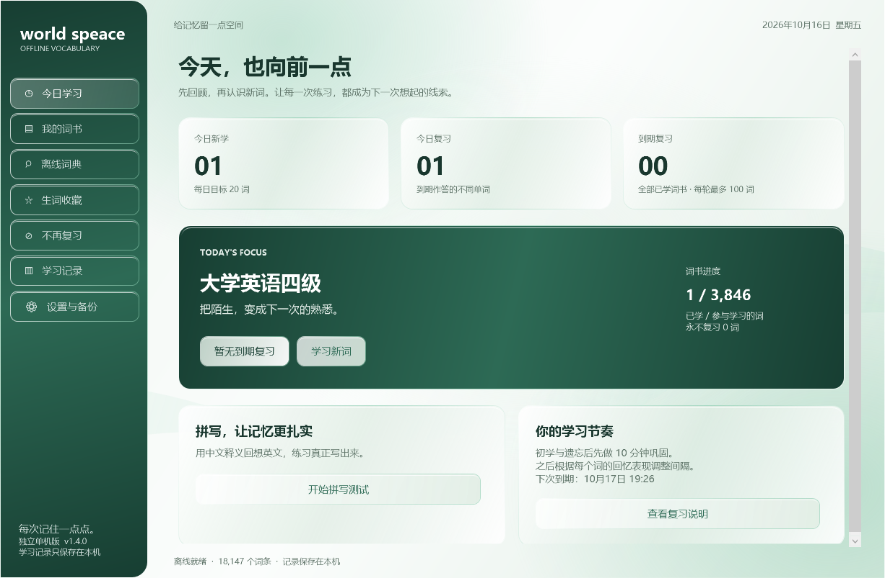

# world speace · Windows 单机词汇学习

一个无需账号和安卓模拟器的 Windows 桌面背词程序。词库、学习记录、收藏和复习安排均保存在本机，日常学习无需联网。

当前版本：**v1.4.0**。程序基于 C# / WPF / .NET Framework 4.8 独立实现，并非“不背单词”官方客户端，也不包含原应用的账号、付费词典或影视原声。

## 下载与运行

前往 [Releases 下载页面](https://github.com/yhc904444-eng/world-speace/releases/latest)，下载 `world-speace_Windows_v1.4.0.zip`，完整解压到有写入权限的文件夹，然后双击 `world speace.exe`。

支持安装有 .NET Framework 4.8 的 Windows 10 / 11。运行发行包不需要安装 Python、Node.js、Java 或开发工具。

升级时先关闭旧程序，用新版程序文件覆盖原目录，**保留 `UserData` 文件夹**即可继续使用已有进度。

## 功能

- **18,147 个离线词条**：音标、英汉释义及可用词形变化。
- **9 个分类词书**：中考、高考、四六级、考研、雅思、托福、GRE 和常用高频词。
- **记忆卡片与到期复习**：初学与遗忘后的短时巩固，结合 FSRS-6 记忆模型安排长期复习；全部已学词书的到期词统一进入复习。
- **拼写练习**：根据中文释义回想英文，单独记录拼写结果。
- **永不复习**：看到已掌握的词可立即排除，退出后续新词、复习和拼写队列；支持在“不再复习”列表恢复。
- **离线查词与收藏**：按英文或中文释义搜索，导出收藏 CSV。
- **自制词书**：导入 UTF-8 CSV / TSV，支持双语例句。
- **离线发音**：使用 Windows 已安装的英语语音。
- **本地进度与备份**：每日目标、练习记录、完整 JSON 导出与恢复。
- **页面外观可选**：五种配色，支持液态玻璃和简洁纯色，切换后立即生效并自动保存。
- **启动与界面动效**：液态玻璃启动面板、流动光晕、图标反光和实际加载进度；板块背景有入场、悬停放大和按下缩小反馈，文字始终保持原尺寸。


启动页采用薄荷绿液态玻璃风格：半透明面板、圆润透光边缘、流动光晕、图标反光及玻璃进度条。图标浮现时文字保持静止，进度来自实际加载；光影动画在启动页关闭时停止。Windows 关闭界面动画或使用软件渲染时，保留静态玻璃外观。

进入应用后，动效仅作用于卡片、按钮的背景，文字不参与缩放和移动，避免动画时字形发虚。词书分类在后台启动加载时整理，切换页面直接使用已有词表。

## 切换页面外观

打开 **设置与备份 → 外观与配色**，可选择 **青竹绿、雾海蓝、柔雾紫、暖杏色、简约灰**。页面风格可选 **液态玻璃** 或 **简洁纯色**，不喜欢玻璃质感时切换到纯色即可。

颜色与风格选中后立即应用并自动保存，重启后保留；不会丢失当前页面中尚未保存的每日目标、朗读等设置。外观也包含在完整 JSON 备份中，旧版进度会自动补齐默认外观。


## 永不复习如何生效

在学习卡片或词典详情点击“永不复习”，当前卡片会跳过，这个英文单词在不同词书中的同名条目也会排除。设置忽略英文大小写，重启后仍有效。

历史记录和收藏保留，词典中仍可查询。误点后可在“不再复习”页面点击“恢复复习”，沿用原来的学习进度和复习日期。不同词形分别处理，例如 `learn` 与 `learned`。

## 复习如何安排

新词首次作答后，先安排 **10 分钟后巩固**。忘记的词也会进入短时重学，并在本轮最多追加出现两次。本轮重现只作练习，即使再次答对也不会取消原定的到期复习；本轮持续超过 10 分钟时，同样需要下一轮完成到期作答。

到期后顺利回忆，进入长期复习。后续间隔由 **FSRS-6** 根据每个词的难度、记忆稳定性、作答结果与实际经过时间计算，按作答时刻向后安排，最长 365 天。首页汇总全部已学词书的到期词，每轮最多 100 词；未完成的词继续保留在到期总数中。

请先在心里回忆释义，再显示答案：**忘记**表示没能独立想起；**模糊**表示独立想起但吃力；**认识**表示顺利想起。需要答案提示才能回忆时应选“忘记”。成熟词的“模糊”对应成功但费力的回忆，采用模型计算间隔，不再强制安排明天，也不使用旧版固定等级跳回 60 天。

卡片和词典详情显示下一次具体时间及原因。新记录保存完整作答时间、阶段、实际间隔与新到期时间，并区分本轮巩固和到期复习。拼写结果独立记录，不改变释义回忆排期。

使用公开默认参数，模型目标保持率为 90%，**不是对实际正确率的保证，也尚未根据你的个人数据训练**。10 分钟步骤、1 天最小长期间隔、365 天上限是本应用的产品设置。旧版日期和历史记录原样保留，到期作答后根据原间隔近似初始化模型；不会伪造旧作答的精确时间。详细规则、来源与验证见 [复习计划说明](docs/review-scheduling.md)。



## 数据与隐私

发行程序的学习数据位于程序同目录下的 `UserData` 文件夹。请不要直接在压缩包内运行，也不要把程序放入只读目录。

本仓库和发行包不包含个人学习记录、备份、错误日志或原 Android APK。复制整个软件目录或导出完整 JSON 备份，都可以保存自己的学习数据。

## 从源码构建

在有 .NET Framework 4.8 的 Windows 上，用 PowerShell 执行：

```powershell
.\build.ps1
```

程序输出到 `dist/world speace.exe`。内置词库与图标已经包含在源码中，普通构建不需要下载数据或安装第三方包。

开发验证入口：

```powershell
$app = Join-Path $PWD 'dist\world speace.exe'
Start-Process -FilePath $app -ArgumentList '--self-test' -Wait
Start-Process -FilePath $app -ArgumentList '--review-tests' -Wait
Start-Process -FilePath $app -ArgumentList '--review-ui-tests' -Wait
Start-Process -FilePath $app -ArgumentList '--exclusion-tests' -Wait
Start-Process -FilePath $app -ArgumentList '--navigation-tests' -Wait
Start-Process -FilePath $app -ArgumentList '--render-tests' -Wait
Start-Process -FilePath $app -ArgumentList '--motion-tests' -Wait
Start-Process -FilePath $app -ArgumentList '--appearance-tests' -Wait
.\package.ps1
```

测试会在 `dist` 内生成独立的测试目录，不修改正常使用的 `UserData`。界面测试需要可运行 WPF 的 Windows 桌面环境。`package.ps1` 在验证输出存在后生成发行 ZIP，并使用明确的文件清单排除学习数据。

复习模型测试包含与官方 `ts-fsrs 5.4.2` 独立生成的 13 组数值对照，以及短时巩固、逾期、跨词书、旧备份与真实界面操作的回归。构建和运行应用不需要 Node.js 或 FSRS 外部服务。

如需重新筛选上游词库，使用 Python 3.11 或更新版本运行 `tools/prepare_dictionary.py`。该步骤需要联网并会更新词库和来源记录。重新生成图标可运行 `tools/make_icon.py`，需要 Pillow；这些工具不是应用运行依赖。

## 词库来源与限制

词库来自 [ECDICT](https://github.com/skywind3000/ECDICT)，按考试标签和词频筛选。上游许可证保留在 [data/ECDICT-LICENSE.txt](data/ECDICT-LICENSE.txt)，筛选规则和 SHA256 在 [data/source.json](data/source.json)。

分类词表存在重叠，用于学习参考，不代表最新官方考试大纲。内置数据没有完整的例句与影视音频；可通过自制词书补充例句。发音取决于 Windows 本地英语语音和可用音频输出，发音失败不会阻断学习或页面切换。

完整操作说明见 [使用说明](使用说明.md)。
