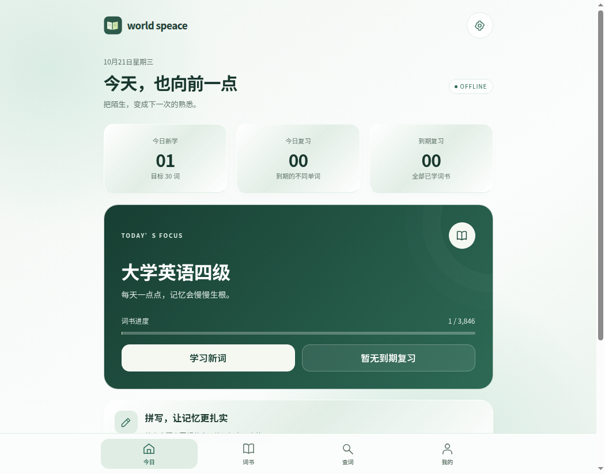
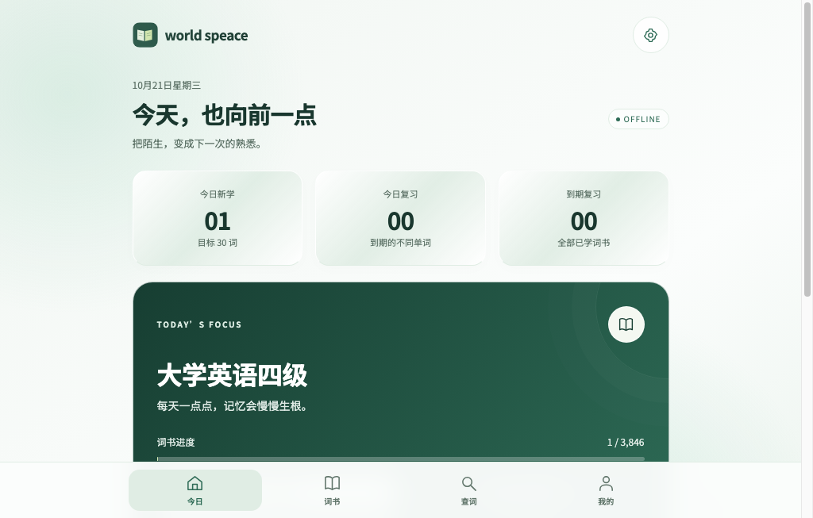
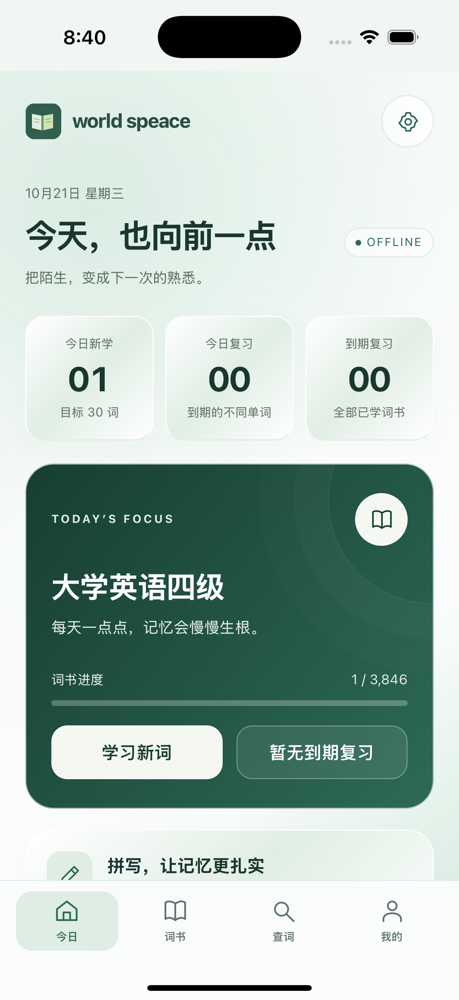

# 多平台交付与验证 · v1.5.1

2026-10-21。Windows 继续为原 v1.5.0；Android 和新增平台为 v1.5.1。所有记录在本机保存，跨设备迁移使用完整 JSON 备份。

## 交付范围

| 平台 | 交付 | 验证与剩余步骤 |
| --- | --- | --- |
| Windows | v1.5.0 ZIP、同版 npm TGZ | 版本和原 EXE SHA256 核对一致，未更改原学习目录 |
| Android | 原签名 v1.5.1 APK、源码 ZIP | APK v2/v3 签名、versionCode 15002、10 个资源的精确路径与哈希；尚未进行真机安装测试 |
| macOS | Intel x64 / Apple Silicon arm64，各有 DMG 和 app ZIP | 两种架构构建及签名检查；arm64 原生进程 8 项检查。仅 ad hoc 签名，仍需 Developer ID 和公证身份才能完成正式 Apple 分发 |
| Linux | x64 / arm64，各有 DEB 和 tar.gz | 两种架构打包及资源校验；Ubuntu 24.04 x64 实际安装 DEB 后，原生进程 8 项检查通过。arm64 未在实际 arm64 Linux 机器运行 |
| iOS/iPadOS | 自包含 Xcode 源码 ZIP、arm64 未签名 IPA | 真机目标成功编译，iOS 模拟器实际启动、学习、原生保存、JSON 导出和重开通过。真机最后一步需要自己的 Apple Team、证书及 provisioning profile |
| 网页 / PWA | 含完整词库、字体与缓存脚本的静态 ZIP | 390×844 页面 29 项检查；关闭服务器后仍能启动、读取 18,147 个词条和内置中文字体，保留 1 张合成卡片与 2 次作答 |

## 核心和安装检查

- Node 核心及存储检查 45 项：包含 13 组 FSRS-6 参考向量、Windows 备份格式、数据写入失败保护、导入和排除，以及 Linux 安装目录权限回归。Windows 本地执行时，权限位检查按系统能力跳过；Ubuntu 构建机全部通过。
- macOS / Linux 原生进程检查：渲染页面没有 Node 接口、保留沙箱、词库加载、内置中文字体加载、作答和设置写入原子文件、完整备份等于保存记录、外部网络请求被拒绝、重新打开后原始进度字节保持一致。
- iOS 模拟器的测试仅存在于 Debug 构建，使用独立的 world-speace-smoke 数据目录。Release IPA 禁用签名，不包含调试测试入口。
- Windows、Android、源码包均检查不含 UserData、私钥、密钥密码和个人学习文件。实际运行测试只使用合成记录。
- 发布前再次检查 APK / ASAR / IPA 的精确词库路径和内容、Linux 目录访问权限、Mach-O / ELF 的 CPU 架构。上传后比较每个 Release 附件的服务端 digest 和本地 SHA256。

原生报告：[Linux](platforms/linux.json)、[macOS](platforms/macos.json)、[iOS 模拟器](platforms/ios.json)。[最终构建及四项成功作业](https://github.com/yhc904444-eng/world-speace/actions/runs/39570509941) 对应代码提交 `72cbd59bb539411fa1deca3680a1797cb3fb8f16`；其后的交付提交仅更新发布说明、截图和验证记录。发布校验链接记录在 GitHub Release 的 platforms.json 和发布说明中。

## 字体和界面

Linux 英文环境最初缺少中文字体。桌面和网页版已内置完整 Noto Sans SC 可变字体，优先使用它显示界面，并在测试截图前等待字体加载和排版。字体来自固定上游提交，SHA256 和 SIL OFL 许可随源码及运行资源分发。

以下截图来自隔离的原生测试记录：

## 升级与限制

Android 直接覆盖安装，不要卸载或清除数据。Windows 保留 UserData。其他桌面端的数据目录独立于安装包；iOS 删除应用会删除本机数据；浏览器清理网站数据可能删除 PWA 进度。升级或迁移前均可在设置中导出完整 JSON。

iOS 交付到待 Apple 身份签名的阶段，尚未提交应用商店。iOS 系统文件选择器、离线语音和具体真机行为仍需设备确认；macOS x64、Linux arm64 尚无相应真实硬件运行报告。网页 ZIP 可部署到 HTTPS 静态服务器，本次没有额外启用 GitHub Pages 或其他托管网站。

HarmonyOS NEXT、电视和手表不在本次独立原生工程范围内。兼容 Android APK 的设备可尝试 Android 包；支持现代浏览器的设备也可使用网页版本。
